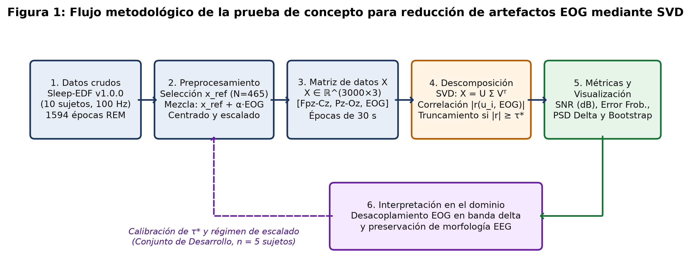
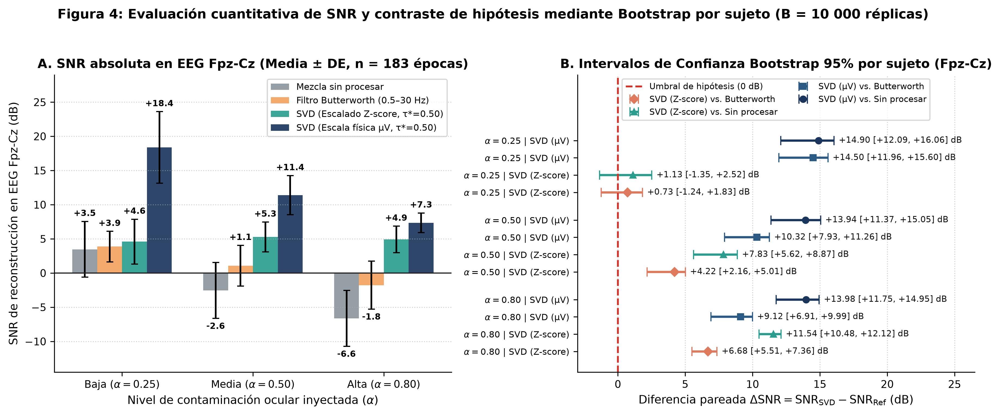

# Reducción de Artefactos Oculares en el EEG de Polisomnografía durante el Sueño REM mediante Descomposición en Valores Singulares (SVD)

**Universidad Distrital Francisco José de Caldas (UDFJC)**  
**Facultad de Ingeniería · Proyecto Curricular de Ingeniería de Sistemas**  
**Asignatura:** Metodología de la Investigación (Segunda Entrega: Ponencia)  
**Docente Asesor:** Prof. Duvan Tellez Castro  

### Autores
- **Cristian Aguilar** (`20241020155`)
- **Sergio Osorio** (`20241020073`)
- **Nicolas Velasco** (`20241020009`)

---

## Entregables Principales en este Repositorio

| Entregable | Archivo | Descripción |
| :--- | :--- | :--- |
| **Cuaderno Reproducible (Jupyter Notebook)** | [`prueba_concepto_svd_rem.ipynb`](./prueba_concepto_svd_rem.ipynb) | Implementación de extremo a extremo ejecutada con salidas visibles sobre 10 sujetos reales de *Sleep-EDF Expanded v1.0.0* (`seed = 2026`). |
| **Presentación de Diapositivas (PDF 16:9)** | [`presentacion_ponencia_svd_rem.pdf`](./presentacion_ponencia_svd_rem.pdf) | Presentación académica de 14 diapositivas compilada en LaTeX Beamer ([código fuente `.tex`](./presentacion_ponencia_svd_rem.tex)). |
| **Documento Escrito de la Ponencia (PDF)** | [`documento_ponencia_svd_rem.pdf`](./documento_ponencia_svd_rem.pdf) | Informe completo de la ponencia con planteamiento, estado del arte (13 referencias IEEE), prueba de concepto y resultados ([versión `.md`](./documento_ponencia_svd_rem.md)). |
| **Guion de Exposición Oral (15 min + Q&A)** | [`guion_ponencia_15min.pdf`](./guion_ponencia_15min.pdf) | Guion cronometrado (`5:00 min` por integrante) con guía rápida de ecuaciones y banco de defensa ([versión `.md`](./guion_ponencia_15min.md)). |
| **Datos Pre-extraídos y Tablas CSV** | [`data/`](./data/) | Dataset comprimido `sleep_edf_rem_10subjects.npz` ($1\,594$ épocas REM = $13.28\text{ h}$) y tablas CSV de calibración, evaluación e intervalos Bootstrap. |
| **Figuras Científicas (300 DPI + SVG)** | [`figures/`](./figures/) | Las 7 figuras del estudio en formatos `.png` y `.svg` vectorial. |

---

## Resumen de la Prueba de Concepto

Durante el sueño REM, los movimientos oculares rápidos generan artefactos de gran amplitud ($50\text{ a }200\,\mu\text{V}$) concentrados entre $0.5\text{ y }4.0\text{ Hz}$, solapándose directamente con la banda delta cerebral ($0.5\text{ a }4.0\text{ Hz}$). En montajes clínicos estándar de pocos canales como *Sleep-EDF* ($2$ canales EEG: `Fpz-Cz`, `Pz-Oz` y $1$ canal `EOG horizontal`), el filtrado clásico Butterworth no logra separar el artefacto sin atenuar la banda delta, y métodos como ICA resultan subdeterminados ($C=3$).

Este repositorio implementa y evalúa un filtro de subespacios basado en **Descomposición en Valores Singulares (SVD)** sobre matrices por época $X \in \mathbb{R}^{3000 \times 3}$ ($30\text{ s}$ a $100\text{ Hz}$):
$$X = U \Sigma V^\top = \sigma_1 u_1 v_1^\top + \sigma_2 u_2 v_2^\top + \sigma_3 u_3 v_3^\top$$
identificando automáticamente los modos oculares mediante su correlación con el canal `EOG` ($|r(u_i, \text{EOG})| \ge \tau^*$) y anulando su peso singular ($\sigma_i = 0$).



---

## Resultados Principales (Partición de Evaluación: `SC4051` a `SC4091`, $N_{\text{eval}} = 183$ épocas REM)

| Nivel $\alpha$ | Método | $\text{SNR}_{\text{out}}$ `Fpz-Cz` (dB) | $\Delta\text{SNR}_{\text{vs Raw}}$ (dB) | $\Delta\text{SNR}_{\text{vs Butt}}$ (dB) y $\text{IC}_{95\%}$ Bootstrap | Error Frobenius $\epsilon_{\text{Frob}}$ | Error PSD Delta $\epsilon_{\text{PSD},\delta}$ |
| :---: | :--- | :---: | :---: | :---: | :---: | :---: |
| **$\alpha = 0.25$** | Señal contaminada | $+3.47 \pm 3.55$ | $0.00$ | $-0.40$ | $0.761$ | $0.440$ |
| *(Baja)* | Filtro Butterworth ($0.5\text{ a }30\text{ Hz}$) | $+3.87 \pm 3.48$ | $+0.40$ | $0.00$ | $0.728$ | $0.320$ |
| | **SVD Escala Física ($\mu\text{V}$, $\tau^*=0.50$)** | **$+18.37 \pm 4.78$** | **$+14.90$** | **$+14.50\;[+11.96, +15.60]$** | **$0.141$** | **$0.159$** |
| | SVD Z-score ($\tau^*=0.50$) | $+4.60 \pm 7.51$ | $+1.13$ | $+0.73\;[-1.63, +2.07]$ *(n.s.)* | $0.688$ | $0.562$ |
| **$\alpha = 0.50$** | Señal contaminada | $-2.55 \pm 3.55$ | $0.00$ | $-3.62$ | $1.522$ | $1.760$ |
| *(Moderada)* | Filtro Butterworth ($0.5\text{ a }30\text{ Hz}$) | $+1.07 \pm 3.63$ | $+3.62$ | $0.00$ | $1.305$ | $1.263$ |
| | **SVD Escala Física ($\mu\text{V}$, $\tau^*=0.50$)** | **$+11.39 \pm 4.92$** | **$+13.94$** | **$+10.32\;[+7.93, +11.26]$** | **$0.257$** | **$0.419$** |
| | SVD Z-score ($\tau^*=0.50$) | $+5.28 \pm 6.45$ | $+7.83$ | $+4.21\;[+1.94, +5.44]$ | $0.625$ | $0.677$ |
| **$\alpha = 0.80$** | Señal contaminada | $-6.63 \pm 3.55$ | $0.00$ | $-4.87$ | $2.435$ | $4.505$ |
| *(Severa)* | Filtro Butterworth ($0.5\text{ a }30\text{ Hz}$) | $-1.77 \pm 3.79$ | $+4.87$ | $0.00$ | $2.036$ | $3.226$ |
| | **SVD Escala Física ($\mu\text{V}$, $\tau^*=0.50$)** | **$+7.35 \pm 4.95$** | **$+13.98$** | **$+9.12\;[+6.91, +9.99]$** | **$0.409$** | **$0.892$** |
| | SVD Z-score ($\tau^*=0.50$) | $+4.91 \pm 5.20$ | $+11.54$ | $+6.68\;[+4.46, +7.66]$ | $0.627$ | $1.044$ |



---

## Instrucciones de Reproducción Rápida

1. **Clonar el repositorio e instalar dependencias:**
   ```bash
   git clone https://github.com/Nicolxsy/ponencia-svd-rem-eeg.git
   cd ponencia-svd-rem-eeg
   pip install -r requirements.txt
   ```
2. **Abrir y ejecutar el cuaderno reproducible:**
   ```bash
   jupyter notebook prueba_concepto_svd_rem.ipynb
   ```
   *(El archivo `data/sleep_edf_rem_10subjects.npz` ya está incluido en el repositorio para ejecución inmediata sin esperar descargas externas; si se desea volver a descargar desde PhysioNet, basta con ejecutar `python download_rem_data.py`).*
3. **Reproducir las métricas y las 7 figuras desde terminal:**
   ```bash
   python compute_eval_metrics.py
   python generate_all_figures.py
   ```
