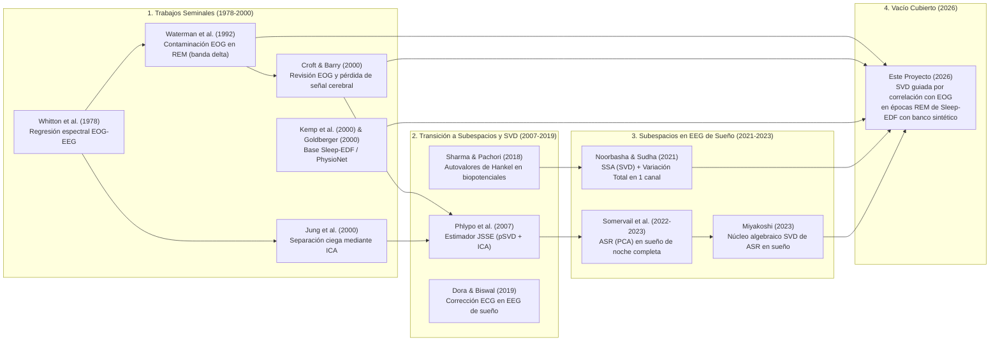
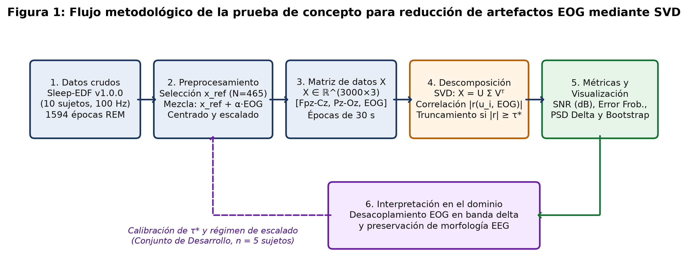
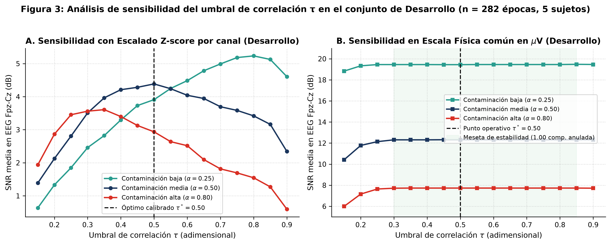
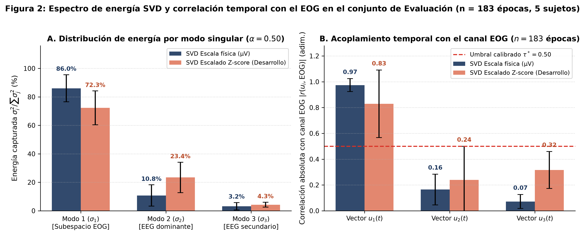
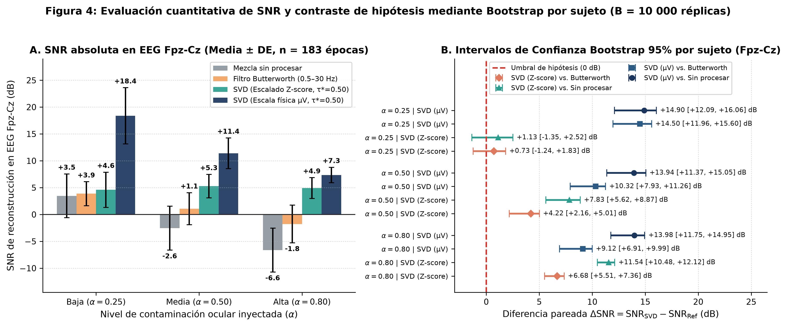
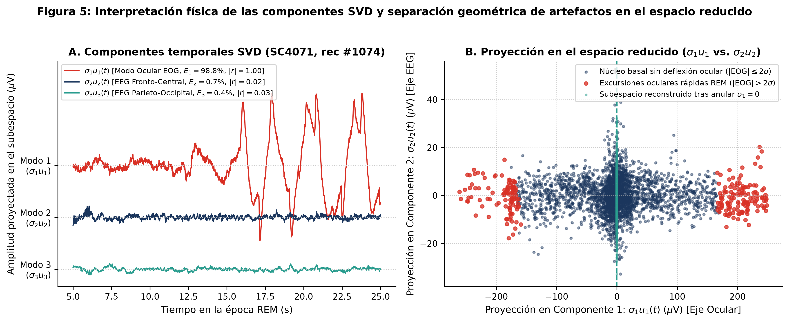
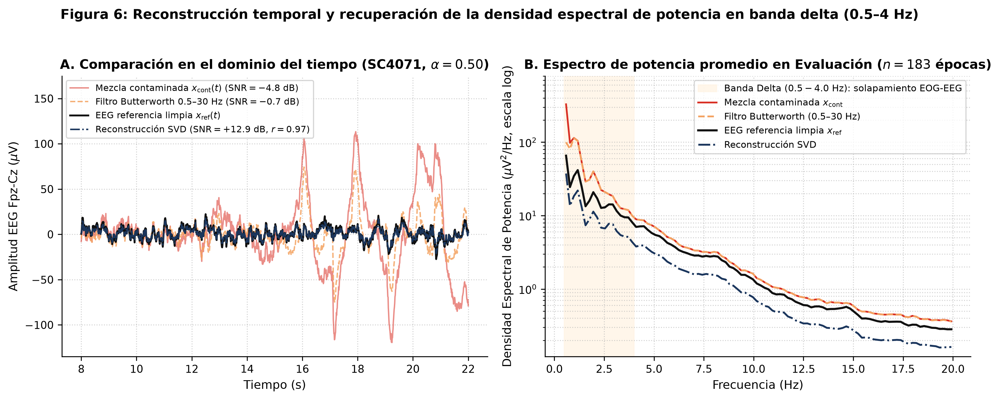
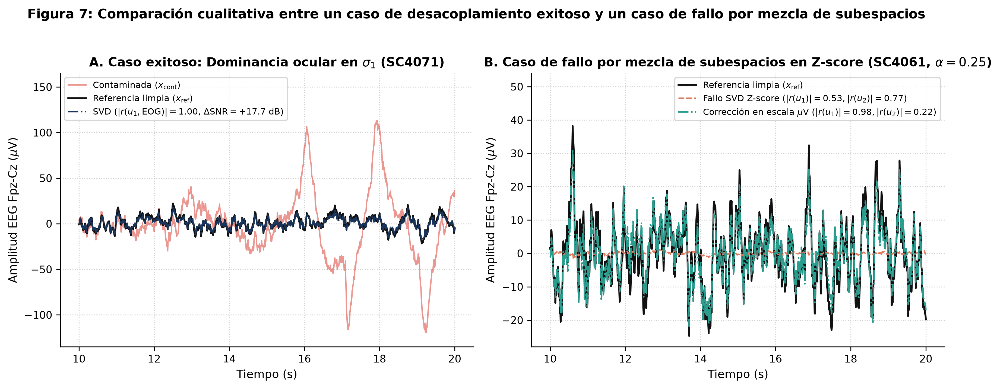

# Reducción de artefactos oculares en el EEG de polisomnografía durante el sueño REM mediante descomposición en valores singulares (SVD)

**Autores:** Cristian Aguilar (`20241020155`), Sergio Osorio (`20241020073`), Nicolas Velasco (`20241020009`)  
**Docente asesor:** Duvan Tellez Castro  
**Afiliación:** Facultad de Ingeniería, Universidad Distrital Francisco José de Caldas (UDFJC)  
**Asignatura:** Metodología de la Investigación (Segunda entrega: Ponencia)  

---

## 1. Problema de Investigación

### 1.1. Contexto y motivación
La polisomnografía (PSG) constituye el estándar clínico para analizar la arquitectura y las etapas del sueño. Durante el sueño de movimientos oculares rápidos (REM), las sacadas oculares y los parpadeos generan dipolos corneorretinianos (electrooculograma, EOG) cuyos campos eléctricos se propagan por conducción de volumen a través del cuero cabelludo y contaminan severamente el electroencefalograma (EEG) [2], [3]. Esta interferencia altera la potencia espectral, la coherencia interhemisférica y la asimetría frontal, dificultando tanto la inspección clínica como el desempeño de algoritmos automáticos de análisis del sueño [2], [11].

### 1.2. Planteamiento del problema
La contaminación ocular durante la fase REM concentra gran parte de su energía en bajas frecuencias ($0.5 - 4\text{ Hz}$), solapándose directamente con la banda delta fisiológica del EEG [2], [7]. Debido a esta superposición espectral, los filtros clásicos en el dominio de la frecuencia (como Butterworth pasa banda o pasa altas) no pueden suprimir el artefacto ocular sin atenuar simultáneamente la actividad cerebral lenta subyacente [2], [3]. A su vez, los métodos de regresión lineal y de separación ciega de fuentes como el Análisis de Componentes Independientes (ICA) presentan limitaciones de contaminación cruzada bidireccional ($\text{EEG} \leftrightarrow \text{EOG}$), pudiendo sustraer actividad neuronal legítima captada por los electrodos perioculares o requerir un número elevado de canales y convergencia estocástica [3], [4]. La Descomposición en Valores Singulares (SVD) proporciona una factorización ortogonal, determinista y de bajo costo computacional de la matriz multicanal; sin embargo, los valores singulares ordenan las componentes únicamente por energía variacional y no identifican por sí mismos la fuente fisiológica de cada modo.

### 1.3. Justificación explícita del ajuste de alcance respecto a la Primera Entrega (Póster)
Siguiendo los lineamientos de la segunda entrega, se documentan y justifican tres depuraciones metodológicas respecto al póster presentado en la primera entrega:
1. **Delimitación exclusiva al artefacto ocular (EOG) y exclusión del artefacto cardíaco (ECG):** Al inspeccionar los encabezados binarios de la base abierta *Sleep-EDF Database Expanded v1.0.0* en PhysioNet [5], [13], se verificó que los registros de la cohorte *Sleep Cassette* (`SC4*`) contienen 7 canales (`EEG Fpz-Cz`, `EEG Pz-Oz`, `EOG horizontal`, `Resp oro-nasal`, `EMG submental`, `Temp rectal` y `Event marker`), pero carecen de derivación electrocardiográfica (ECG). En consecuencia, el estudio se delimitó de forma rigurosa al desacoplamiento ocular mediante el canal `EOG horizontal` disponible a $100\text{ Hz}$.
2. **Focalización en épocas de sueño REM:** La literatura seminal demuestra que el acoplamiento $\text{EOG} \to \text{EEG}$ en la banda delta es crítico específicamente durante el sueño REM debido a las ráfagas sacádicas características de este estadio [2]. Acotar el análisis a ventanas de $30\text{ s}$ anotadas por expertos como estadio R permite evaluar el método donde el fenómeno físico es más intenso.
3. **Adopción de un banco de mezclas sintéticas controladas:** En señales clínicas crudas, la señal cerebral verdadera libre de interferencia ocular es desconocida, lo que impide cuantificar con exactitud si un método borra actividad neuronal junto con el artefacto [3], [11]. Construir mezclas aditivas controladas ($x_{\text{cont}}(t) = x_{\text{ref}}(t) + \alpha \cdot eog(t)$) a partir de segmentos REM de referencia ($x_{\text{ref}}$) permite calcular de manera exacta la relación señal-ruido ($\text{SNR}$) de reconstrucción.

### 1.4. Pregunta de investigación
En épocas REM de *Sleep-EDF Expanded*, ¿en qué medida la eliminación mediante SVD de los componentes de la matriz $\text{EEG-EOG}$ asociados con el canal EOG modifica la relación señal-ruido ($\text{SNR}$) del EEG en mezclas sintéticas con contaminación ocular conocida, frente al EEG contaminado sin procesar y frente al EEG procesado con un filtro pasa banda de referencia?

### 1.5. Objetivo general y objetivos específicos
**Objetivo general:** Evaluar el efecto de una reducción de artefactos oculares basada en SVD sobre la $\text{SNR}$ de reconstrucción del EEG en épocas REM de *Sleep-EDF Expanded*, mediante mezclas sintéticas con contaminación EOG conocida, frente al EEG contaminado sin procesar y al EEG procesado con un filtro de frecuencia de referencia.

**Objetivos específicos:**
1. Identificar los registros de *Sleep-EDF Expanded v1.0.0* con PSG e hipnograma disponibles, seleccionar las épocas de $30\text{ s}$ anotadas como REM y verificar en cada archivo EDF la presencia, etiqueta, unidades físicas y frecuencia de muestreo de `EEG Fpz-Cz`, `EEG Pz-Oz` y `EOG horizontal`.
2. Construir un banco de mezclas sintéticas sumando EOG horizontal escalado ($\alpha$) a segmentos EEG de referencia inspeccionados, separando estrictamente los sujetos en conjuntos de desarrollo y evaluación.
3. Formar para cada época la matriz $X \in \mathbb{R}^{3000 \times 3}$ (`[Fpz-Cz, Pz-Oz, EOG]`), centrarla y evaluar su régimen de escalado antes de aplicar SVD.
4. Identificar como candidatos a artefacto los componentes temporales SVD ($u_i$) cuya correlación absoluta con el canal EOG supere un umbral $\tau^*$ calibrado en el conjunto de desarrollo, analizando la sensibilidad frente a umbrales alternativos.
5. Reconstruir los canales EEG tras anular los componentes candidatos y cuantificar el espectro de valores singulares, la energía capturada, el error relativo en norma de Frobenius y la $\text{SNR}$ respecto a la señal EEG de referencia conocida.
6. Comparar la $\text{SNR}$ obtenida con SVD frente a la mezcla sin procesar y frente a un filtro pasa banda Butterworth de 4.º orden ($0.5 - 30\text{ Hz}$, fase cero), mediante intervalos de confianza bootstrap pareados del $95\%$ por sujeto.

### 1.6. Hipótesis y definición operativa
En mezclas sintéticas REM con contaminación ocular introducida escalando el EOG, la eliminación de los componentes SVD correlacionados con el canal EOG aumentará la $\text{SNR}$ de reconstrucción del EEG frente a la señal sin procesar y frente al filtro Butterworth de referencia. Se considerará que SVD supera estadísticamente a cada comparador si el límite inferior del intervalo de confianza bootstrap del $95\%$ (remuestreo por sujeto) para la diferencia pareada $\Delta\text{SNR} = \text{SNR}_{\text{SVD}} - \text{SNR}_{\text{ref}}$ es mayor que $0\text{ dB}$.

---

## 2. Estado del Arte

### 2.1. Evolución metodológica y relaciones entre trabajos seminales y recientes
La revisión de literatura comprende 13 referencias verificadas que trazan la evolución desde los métodos clásicos de sustracción espectral hasta la reconstrucción algebraica de subespacios en sueño:

### 2.2. Línea temporal de antecedentes

| Año | Autores y referencia | Aporte principal e influencia directa en el proyecto |
| :--- | :--- | :--- |
| **1978** | Whitton, Lue & Moldofsky [1] | Proponen el método seminal de regresión en el dominio de la frecuencia para estimar y restar la transferencia $\text{EOG} \to \text{EEG}$. |
| **1992** | Waterman et al. [2] | Primer estudio sistemático del artefacto EOG durante el sueño REM: demuestran que la contaminación domina la banda delta en derivaciones frontales y decae hacia regiones occipitales. |
| **2000** | Croft & Barry [3] | Revisan los métodos de corrección ocular y demuestran que la regresión sustrae actividad cerebral legítima captada por el EOG, motivando el uso de mezclas con referencia conocida. |
| **2000** | Jung et al. [4] | Introducen ICA para separar artefactos multicanal, advirtiendo que la propagación entre EEG y EOG es bidireccional. |
| **2000** | Kemp et al. [5] y Goldberger et al. [6] | Publican el estándar de registros polisomnográficos de *Sleep-EDF* y la infraestructura abierta de *PhysioNet* [13], fuente de datos de esta investigación. |
| **2007** | Phlypo et al. [7] | Desarrollan el estimador conjunto de subespacios (JSSE) combinando SVD por ventanas (pSVD) con ICA para aislar componentes oculares suaves. |
| **2018** | Sharma & Pachori [8] | Demuestran que los autovalores extremos de matrices de trayectoria aislan interferencias de alta energía (deriva de línea base y red eléctrica). |
| **2019** | Dora & Biswal [9] | Corrigen artefactos cardíacos de intensidad variable en EEG de sueño; documenta la línea de artefacto ECG que queda como trabajo futuro al no existir canal ECG en *Sleep-EDF*. |
| **2021** | Noorbasha & Sudha [10] | Aplican descomposición en valores singulares (mediante SSA) combinada con variación total para suprimir artefactos de movimiento en EEG de un solo canal. |
| **2022–2023** | Somervail et al. [11] | Validan por primera vez *Artifact Subspace Reconstruction* (ASR, basado en PCA) en EEG de sueño de noche completa, probando que una calibración inadecuada borra ondas lentas. |
| **2023** | Miyakoshi [12] | Formaliza el núcleo algebraico de la limpieza de subespacios en sueño como una proyección ortogonal y truncamiento mediante SVD. |
| **2026** | **Este proyecto** | Evalúa de forma controlada la reconstrucción de subespacios mediante SVD guiada por correlación con el canal EOG específicamente en épocas REM de *Sleep-EDF Expanded*. |

---

## 3. Prueba de Concepto (Diseño Metodológico e Implementación)

*Conclusión de la Figura 1:* El flujo metodológico integra la extracción de épocas REM reales desde *Sleep-EDF*, la síntesis controlada con referencia conocida ($x_{\text{ref}}$) y un lazo cerrado de calibración en el conjunto de Desarrollo ($n = 5$ sujetos) que fija los hiperparámetros ($\tau^*$ y el régimen de escalado) sin fuga de información hacia el conjunto de Evaluación independiente ($n = 5$ sujetos).

### 3.1. Datos utilizados y partición experimental
Se descargaron y procesaron los registros polisomnográficos de primera noche (`E0-PSG.edf`) y sus respectivos hipnogramas anotados manualmente bajo el estándar Rechtschaffen & Kales (`Hypnogram.edf`) de **10 sujetos distintos** pertenecientes a la cohorte *Sleep Cassette* de *Sleep-EDF Database Expanded v1.0.0* [5], [13]:
* **Variables (canales):** `EEG Fpz-Cz` (frontal-central, en $\mu\text{V}$), `EEG Pz-Oz` (parietal-occipital, en $\mu\text{V}$) y `EOG horizontal` (periocular, en $\mu\text{V}$).
* **Resolución temporal:** Frecuencia de muestreo verificada en el encabezado EDF de $f_s = 100.0\text{ Hz}$; cada época de $30\text{ s}$ contiene exactamente $N = 3000$ muestras por canal ($9000$ muestras por época en la matriz $X \in \mathbb{R}^{3000 \times 3}$).
* **Muestra total extraída:** Se extrajeron la totalidad de las **1594 épocas de $30\text{ s}$ anotadas como estadio REM (`Sleep stage R`)**, equivalentes a $797.0\text{ minutos}$ ($13.28\text{ horas}$) de sueño REM neto ($4.782 \times 10^6$ muestras temporales por canal).
* **Partición estricta por sujeto:** Los primeros 5 sujetos (`SC4001` a `SC4041`, 863 épocas REM) se asignaron al conjunto de **Desarrollo** (calibración de umbral y preprocesamiento) y los 5 sujetos restantes (`SC4051` a `SC4091`, 731 épocas REM) al conjunto de **Evaluación** independiente.

**Cuadro 1: Caracterización de los 10 sujetos reales de *Sleep-EDF Expanded v1.0.0* procesados en la Prueba de Concepto.**

| Sujeto | Archivo PSG (`.edf`) | Archivo Hipnograma | Partición | Épocas totales noche ($30\text{ s}$) | Episodios REM | Épocas REM ($30\text{ s}$) | Duración REM ($\text{min}$) | Épocas de referencia $x_{\text{ref}}$ |
| :--- | :--- | :--- | :--- | :---: | :---: | :---: | :---: | :---: |
| `SC4001` | `SC4001E0-PSG.edf` | `SC4001EC-Hypnogram.edf` | Desarrollo | 2650 | 6 | 125 | 62.5 | 38 |
| `SC4011` | `SC4011E0-PSG.edf` | `SC4011EH-Hypnogram.edf` | Desarrollo | 2802 | 8 | 170 | 85.0 | 58 |
| `SC4021` | `SC4021E0-PSG.edf` | `SC4021EH-Hypnogram.edf` | Desarrollo | 2804 | 15 | 163 | 81.5 | 51 |
| `SC4031` | `SC4031E0-PSG.edf` | `SC4031EC-Hypnogram.edf` | Desarrollo | 2820 | 10 | 209 | 104.5 | 77 |
| `SC4041` | `SC4041E0-PSG.edf` | `SC4041EC-Hypnogram.edf` | Desarrollo | 2570 | 24 | 196 | 98.0 | 58 |
| **Subtotal Desarrollo** | **5 sujetos** | **5 hipnogramas** | **Desarrollo** | **13 646** | **63** | **863** | **431.5** | **282** |
| `SC4051` | `SC4051E0-PSG.edf` | `SC4051EC-Hypnogram.edf` | Evaluación | 2722 | 3 | 68 | 34.0 | 18 |
| `SC4061` | `SC4061E0-PSG.edf` | `SC4061EC-Hypnogram.edf` | Evaluación | 2770 | 4 | 102 | 51.0 | 28 |
| `SC4071` | `SC4071E0-PSG.edf` | `SC4071EC-Hypnogram.edf` | Evaluación | 2810 | 11 | 198 | 99.0 | 59 |
| `SC4081` | `SC4081E0-PSG.edf` | `SC4081EC-Hypnogram.edf` | Evaluación | 2796 | 4 | 131 | 65.5 | 35 |
| `SC4091` | `SC4091E0-PSG.edf` | `SC4091EC-Hypnogram.edf` | Evaluación | 2732 | 17 | 232 | 116.0 | 43 |
| **Subtotal Evaluación** | **5 sujetos** | **5 hipnogramas** | **Evaluación** | **13 830** | **39** | **731** | **365.5** | **183** |
| **Total General** | **10 sujetos** | **10 hipnogramas** | **Ambas** | **27 476** | **102** | **1594** | **797.0** | **465** |

### 3.2. Preprocesamiento y construcción del banco de mezclas sintéticas
1. **Selección de segmentos EEG de referencia ($x_{\text{ref}}$):** De las 1594 épocas REM, se seleccionaron aquellas épocas ($N_{\text{ref}} = 465$: $282$ en Desarrollo y $183$ en Evaluación) cuyos canales EEG basales cumplían simultáneamente ausencia de acoplamiento ocular previo ($|r(\text{Fpz-Cz}, \text{EOG})| < 0.15$ y $|r(\text{Pz-Oz}, \text{EOG})| < 0.15$), ausencia de espigas de movimiento o saturación ($\sigma_{\text{EEG}} < 25\,\mu\text{V}$ y $\max_t |x_{\text{EEG}}(t)| < 120\,\mu\text{V}$) y presencia de actividad ocular activa en el canal EOG ($\sigma_{\text{EOG}} > 15\,\mu\text{V}$). En esta muestra depurada, la desviación estándar media fue de $9.98 \pm 3.06\,\mu\text{V}$ para `Fpz-Cz`, $7.83 \pm 3.31\,\mu\text{V}$ para `Pz-Oz` y $39.69 \pm 22.84\,\mu\text{V}$ para `EOG horizontal` (con excursiones pico a pico medias de $322.4\,\mu\text{V}$).
2. **Centrado e inyección de contaminación controlada:** Cada época se centra a media cero ($\mu = 0\,\mu\text{V}$) para remover el nivel DC de los amplificadores. Luego se construye la mezcla sintética inyectando el canal EOG concurrente con un factor $\alpha$ sobre la derivación frontal `Fpz-Cz` y un factor atenuado $\beta \alpha$ ($\beta = 0.30$, coherente con el gradiente anteroposterior reportado por Waterman et al. [2]) sobre la derivación posterior `Pz-Oz`:
   $$x_{\text{cont, Fpz-Cz}}(t) = x_{\text{ref, Fpz-Cz}}(t) + \alpha \cdot eog(t), \qquad x_{\text{cont, Pz-Oz}}(t) = x_{\text{ref, Pz-Oz}}(t) + 0.30\,\alpha \cdot eog(t)$$
   Se evaluaron tres regímenes de contaminación: **baja ($\alpha = 0.25$)**, **media ($\alpha = 0.50$, nivel nominal de referencia)** y **alta ($\alpha = 0.80$)**.
3. **Evaluación de dos regímenes de escalado previo a SVD:**
   * **Régimen 1 (`SVD_Zscore`, escalado por canal con parámetros de Desarrollo):** Cada columna $j \in \{1, 2, 3\}$ se divide por su desviación estándar global $\sigma_{\text{dev}, j}$ estimada en el conjunto de Desarrollo, igualando la varianza de los tres canales a $\approx 1.0$ antes de aplicar SVD y restituyendo la escala original tras reconstruir.
   * **Régimen 2 (`SVD_Fisico_uV`, preservación de escala física común en $\mu\text{V}$):** Aprovechando que los tres canales están registrados en la misma unidad física ($\mu\text{V}$), la matriz centrada se descompone directamente en microvoltios, conservando la dominancia energética natural del canal EOG ($\sigma_{\text{EOG}} \approx 4 \times \sigma_{\text{EEG}}$).

### 3.3. Formulación matricial y criterio de truncamiento SVD
Para cada época de $30\text{ s}$, la matriz de datos se organiza como $X \in \mathbb{R}^{3000 \times 3}$, donde cada fila $t \in \{1, \dots, 3000\}$ representa un instante temporal ($t / 100\text{ s}$) y las tres columnas corresponden a `[EEG Fpz-Cz, EEG Pz-Oz, EOG horizontal]`. Aplicando SVD de rango económico:
$$X = U \Sigma V^\top = \sum_{i=1}^{3} \sigma_i u_i v_i^\top, \qquad \sigma_1 \ge \sigma_2 \ge \sigma_3 \ge 0$$
donde $u_i \in \mathbb{R}^{3000}$ son los vectores singulares izquierdos (evolución temporal ortonormal), $\sigma_i$ son los valores singulares (raíz de la energía de cada modo, $E_i = \sigma_i^2 / \sum_{j=1}^{3} \sigma_j^2$) y $v_i \in \mathbb{R}^{3}$ son los vectores singulares derechos (pesos espaciales topográficos sobre los tres canales).

Para cada modo $i \in \{1, 2, 3\}$, se calcula el coeficiente de correlación de Pearson absoluto respecto al canal EOG original de la época:
$$r_i = \left| \frac{\sum_{t=1}^{N} u_i(t) \cdot eog(t)}{\|u_i\|_2 \, \|eog\|_2} \right|$$
Todo modo que verifique $r_i \ge \tau^*$ se clasifica como perteneciente al subespacio de artefacto ocular ($i \in K$) y su valor singular se anula ($\tilde{\sigma}_i = 0$). La matriz limpia se reconstruye proyectando los modos restantes:
$$\hat{X} = \sum_{i \notin K} \sigma_i u_i v_i^\top$$

### 3.4. Implementación y comparadores de línea base
El pipeline se implementó en **Python 3.14.7** empleando `NumPy` (`np.linalg.svd`) para la factorización matricial, `SciPy` (`scipy.signal.butter`, `filtfilt`, `welch`) para el filtrado digital y estimación espectral Welch, `pandas` para la estructuración tabular y `Matplotlib` para la visualización científica. Cada época reconstruida se compara contra dos líneas base preespecificadas:
1. **Mezcla contaminada sin procesar ($x_{\text{cont}}$):** Nivel basal de deterioro introducido por el EOG.
2. **Filtro pasa banda Butterworth de referencia:** Filtro Butterworth de 4.º orden con banda de paso de $0.5\text{ a }30.0\text{ Hz}$ aplicado bidireccionalmente con fase cero (`scipy.signal.filtfilt`), que representa el preprocesamiento espectral estándar en polisomnografía clínica.

---

## 4. Resultados Cuantitativos

### 4.1. Calibración del umbral $\tau^*$ y sensibilidad en el conjunto de Desarrollo
Antes de tocar el conjunto de Evaluación, se barraron 16 valores del umbral de correlación $\tau \in [0.15, 0.90]$ (paso de $0.05$) sobre las $N_{\text{dev}} = 282$ épocas REM de los 5 sujetos de Desarrollo.

*Conclusión de la Figura 3:* En el conjunto de Desarrollo ($n = 282$ épocas), el escalado por canal (`SVD_Zscore`, Panel A) presenta una curva cóncava sensible al umbral con máximo global promedio en $\tau^* = 0.50$ ($\text{SNR} = +4.39\text{ dB}$ para $\alpha = 0.50$), degradándose para $\tau < 0.35$ por sobre-truncamiento ($>1.47$ componentes eliminadas) y para $\tau > 0.70$ por sub-truncamiento. En contraste, descomponer la matriz en su escala física común en $\mu\text{V}$ (`SVD_Fisico_uV`, Panel B) exhibe una meseta de estabilidad plana en todo el intervalo $\tau \in [0.30, 0.85]$, donde se anula exactamente $1.00$ componente por época y se alcanza una $\text{SNR}$ de $+19.47\text{ dB}$ ($\alpha = 0.25$), $+12.32\text{ dB}$ ($\alpha = 0.50$) y $+7.73\text{ dB}$ ($\alpha = 0.80$). Con base en este resultado, se fijó $\tau^* = 0.50$ para evaluar ambos esquemas en el conjunto de Evaluación.

### 4.2. Espectro de valores singulares y energía capturada en Evaluación
Siguiendo el Cuadro 1 de la guía de la ponencia para la herramienta SVD, el Cuadro 2 y la Figura 2 reportan el espectro de valores singulares ($\sigma_1, \sigma_2, \sigma_3$), la proporción de energía de Frobenius capturada por cada modo ($E_i$) y la correlación temporal $|r(u_i, \text{EOG})|$ sobre las $N_{\text{eval}} = 183$ épocas de los 5 sujetos de Evaluación.

**Cuadro 2: Espectro de valores singulares, energía capturada y acoplamiento con EOG en el conjunto de Evaluación ($n = 183$ épocas, 5 sujetos; Media $\pm$ DE).**

| Régimen SVD | Nivel $\alpha$ | $\sigma_1$ | $\sigma_2$ | $\sigma_3$ | Energía $E_1$ ($\%$) | Energía $E_2$ ($\%$) | Energía $E_3$ ($\%$) | $\|r(u_1, \text{EOG})\|$ | $\|r(u_2, \text{EOG})\|$ | $\|r(u_3, \text{EOG})\|$ | Comp. anuladas ($\tau^*=0.50$) |
| :--- | :---: | :---: | :---: | :---: | :---: | :---: | :---: | :---: | :---: | :---: | :---: |
| **Escala física ($\mu\text{V}$)** | $0.25$ | $1888.1 \pm 997.2$ | $631.7 \pm 165.6$ | $333.9 \pm 104.3$ | $82.25 \pm 11.66$ | $13.78 \pm 9.25$ | $3.97 \pm 3.19$ | $0.98 \pm 0.07$ | $0.12 \pm 0.13$ | $0.04 \pm 0.03$ | $1.01 \pm 0.07$ |
| **Escala física ($\mu\text{V}$)** | $0.50$ | $2071.7 \pm 1082.8$ | $595.5 \pm 155.6$ | $321.1 \pm 98.2$ | $86.03 \pm 9.53$ | $10.77 \pm 7.46$ | $3.20 \pm 2.59$ | $0.97 \pm 0.05$ | $0.16 \pm 0.12$ | $0.07 \pm 0.05$ | $1.02 \pm 0.13$ |
| **Escala física ($\mu\text{V}$)** | $0.80$ | $2399.1 \pm 1248.6$ | $553.4 \pm 145.9$ | $297.0 \pm 88.0$ | $90.32 \pm 7.16$ | $7.52 \pm 5.66$ | $2.16 \pm 1.76$ | $0.97 \pm 0.04$ | $0.17 \pm 0.10$ | $0.10 \pm 0.07$ | $1.01 \pm 0.10$ |
| **Escalado Z-score** | $0.25$ | $74.9 \pm 29.0$ | $45.0 \pm 11.7$ | $24.9 \pm 7.0$ | $65.52 \pm 9.88$ | $26.41 \pm 8.45$ | $8.08 \pm 2.59$ | $0.66 \pm 0.30$ | $0.41 \pm 0.23$ | $0.45 \pm 0.22$ | $1.48 \pm 0.57$ |
| **Escalado Z-score** | $0.50$ | $75.3 \pm 35.3$ | $38.1 \pm 10.0$ | $16.5 \pm 4.2$ | $72.29 \pm 11.86$ | $23.44 \pm 10.67$ | $4.27 \pm 1.74$ | $0.83 \pm 0.26$ | $0.24 \pm 0.26$ | $0.32 \pm 0.14$ | $1.15 \pm 0.39$ |
| **Escalado Z-score** | $0.80$ | $77.9 \pm 39.0$ | $30.3 \pm 8.7$ | $11.2 \pm 2.8$ | $80.69 \pm 11.20$ | $17.06 \pm 10.32$ | $2.25 \pm 1.19$ | $0.92 \pm 0.13$ | $0.19 \pm 0.19$ | $0.22 \pm 0.10$ | $1.11 \pm 0.35$ |

*Conclusión de la Figura 2:* En escala física ($\mu\text{V}$), el primer modo singular ($\sigma_1$) concentra el $86.0\%$ de la energía total de la matriz ($\alpha = 0.50$) y alcanza una correlación casi unitaria con el canal EOG ($|r(u_1, \text{EOG})| = 0.97 \pm 0.05$), mientras que los modos $\sigma_2$ y $\sigma_3$ quedan desacoplados del artefacto ($|r| \le 0.16$) y retienen la actividad cerebral de `Fpz-Cz` y `Pz-Oz`. Bajo escalado Z-score, igualar artificialmente la varianza de los tres canales reduce la brecha entre $\sigma_1$ y $\sigma_2$, dispersando parte de la correlación ocular hacia $u_2$ ($0.24$) y $u_3$ ($0.32$).

### 4.3. Desempeño de reconstrucción y contraste de hipótesis Bootstrap
El Cuadro 3 presenta las métricas objetivas de reconstrucción en el conjunto de Evaluación ($n = 183$ épocas) para cada método y nivel de contaminación $\alpha$, incluyendo la $\text{SNR}$ en `Fpz-Cz` y `Pz-Oz` ($\text{dB}$), el error cuadrático medio ($\text{RMSE}$ en $\mu\text{V}$), la correlación de Pearson $r$ frente a la referencia limpia, el error relativo de reconstrucción en norma de Frobenius ($\|X_{\text{EEG,ref}} - \hat{X}_{\text{EEG}}\|_F / \|X_{\text{EEG,ref}}\|_F$) y el error relativo de potencia espectral en la banda delta ($0.5 - 4.0\text{ Hz}$).

**Cuadro 3: Desempeño cuantitativo de reconstrucción del EEG en el conjunto de Evaluación ($n = 183$ épocas, 5 sujetos; Media $\pm$ DE).**

| Nivel $\alpha$ | Método evaluado | $\text{SNR}_{\text{Fpz-Cz}}$ ($\text{dB}$) | $\text{SNR}_{\text{Pz-Oz}}$ ($\text{dB}$) | $\text{RMSE}_{\text{Fpz-Cz}}$ ($\mu\text{V}$) | Correlación $r_{\text{Fpz-Cz}}$ | Error relativo Frobenius $\varepsilon_{\text{rel}}$ | Error rel. PSD Delta ($0.5-4\text{ Hz}$) |
| :---: | :--- | :---: | :---: | :---: | :---: | :---: | :---: |
| **$0.25$** | Mezcla sin procesar | $+3.47 \pm 4.09$ | $+9.46 \pm 4.69$ | $8.30 \pm 4.44$ | $0.799 \pm 0.133$ | $0.653 \pm 0.318$ | $0.449 \pm 0.564$ |
| **$0.25$** | Filtro Butterworth ($0.5-30\text{ Hz}$) | $+3.87 \pm 2.23$ | $+5.03 \pm 1.99$ | $7.46 \pm 2.66$ | $0.756 \pm 0.118$ | $0.638 \pm 0.155$ | $0.281 \pm 0.424$ |
| **$0.25$** | SVD (Escalado Z-score, $\tau^*=0.50$) | $+4.60 \pm 3.28$ | $+9.39 \pm 5.44$ | $7.02 \pm 2.96$ | $0.729 \pm 0.293$ | $0.584 \pm 0.222$ | $0.623 \pm 0.323$ |
| **$0.25$** | **SVD (Escala física $\mu\text{V}$, $\tau^*=0.50$)** | **$+18.37 \pm 5.24$** | **$+21.54 \pm 5.53$** | **$1.77 \pm 1.78$** | **$0.983 \pm 0.059$** | **$0.139 \pm 0.102$** | **$0.160 \pm 0.103$** |
| **$0.50$** | Mezcla sin procesar | $-2.55 \pm 4.09$ | $+3.44 \pm 4.69$ | $16.60 \pm 8.89$ | $0.582 \pm 0.178$ | $1.305 \pm 0.636$ | $1.760 \pm 2.199$ |
| **$0.50$** | Filtro Butterworth ($0.5-30\text{ Hz}$) | $+1.07 \pm 2.98$ | $+3.64 \pm 2.47$ | $10.52 \pm 4.52$ | $0.628 \pm 0.165$ | $0.867 \pm 0.305$ | $1.263 \pm 1.651$ |
| **$0.50$** | SVD (Escalado Z-score, $\tau^*=0.50$) | $+5.28 \pm 2.18$ | $+10.33 \pm 3.74$ | $6.47 \pm 2.85$ | $0.827 \pm 0.175$ | $0.507 \pm 0.151$ | $0.521 \pm 0.238$ |
| **$0.50$** | **SVD (Escala física $\mu\text{V}$, $\tau^*=0.50$)** | **$+11.39 \pm 2.87$** | **$+16.89 \pm 4.14$** | **$3.41 \pm 2.45$** | **$0.967 \pm 0.093$** | **$0.257 \pm 0.119$** | **$0.419 \pm 0.113$** |
| **$0.80$** | Mezcla sin procesar | $-6.63 \pm 4.09$ | $-0.64 \pm 4.69$ | $26.56 \pm 14.22$ | $0.420 \pm 0.172$ | $2.088 \pm 1.017$ | $4.474 \pm 5.604$ |
| **$0.80$** | Filtro Butterworth ($0.5-30\text{ Hz}$) | $-1.77 \pm 3.50$ | $+1.92 \pm 3.10$ | $14.85 \pm 7.21$ | $0.508 \pm 0.185$ | $1.199 \pm 0.512$ | $3.305 \pm 4.193$ |
| **$0.80$** | SVD (Escalado Z-score, $\tau^*=0.50$) | $+4.91 \pm 1.95$ | $+8.82 \pm 3.62$ | $6.61 \pm 2.47$ | $0.832 \pm 0.118$ | $0.535 \pm 0.141$ | $0.393 \pm 0.260$ |
| **$0.80$** | **SVD (Escala física $\mu\text{V}$, $\tau^*=0.50$)** | **$+7.35 \pm 1.44$** | **$+13.24 \pm 3.50$** | **$5.07 \pm 2.26$** | **$0.964 \pm 0.073$** | **$0.385 \pm 0.092$** | **$0.643 \pm 0.071$** |

Para contrastar formalmente la hipótesis de investigación, el Cuadro 4 y la Figura 4 muestran las diferencias pareadas $\Delta\text{SNR}$ junto con sus intervalos de confianza bootstrap del $95\%$ calculados con $B = 10\,000$ remuestreos por clúster de sujeto (y por época).

**Cuadro 4: Contraste de hipótesis mediante intervalos de confianza Bootstrap del $95\%$ ($B = 10\,000$ réplicas) para la ganancia $\Delta\text{SNR}$ en `EEG Fpz-Cz` y `EEG Pz-Oz`.**

| Nivel $\alpha$ | Comparación pareada | $\Delta\text{SNR}_{\text{Fpz-Cz}}$ ($\text{dB}$) | IC $95\%$ Bootstrap por Sujeto (`Fpz-Cz`) | IC $95\%$ Bootstrap por Época (`Fpz-Cz`) | Épocas mejoradas (`Fpz-Cz`) | $\Delta\text{SNR}_{\text{Pz-Oz}}$ ($\text{dB}$) | IC $95\%$ Bootstrap por Sujeto (`Pz-Oz`) | ¿Cumple $\text{IC}_{\text{inf}} > 0\text{ dB}$? |
| :---: | :--- | :---: | :---: | :---: | :---: | :---: | :---: | :---: |
| **$0.25$** | SVD ($\mu\text{V}$) vs. Sin procesar | $+14.90 \pm 8.18$ | $[+12.09, +16.06]\text{ dB}$ | $[+13.72, +16.07]\text{ dB}$ | $94.5\%$ | $+12.08$ | $[+10.12, +13.14]\text{ dB}$ | **Sí (Confirmada)** |
| **$0.25$** | SVD ($\mu\text{V}$) vs. Butterworth | $+14.50 \pm 6.38$ | $[+11.96, +15.60]\text{ dB}$ | $[+13.58, +15.40]\text{ dB}$ | $97.8\%$ | $+16.51$ | $[+13.27, +18.24]\text{ dB}$ | **Sí (Confirmada)** |
| **$0.25$** | SVD (Z-score) vs. Sin procesar | $+1.13 \pm 5.38$ | $[-1.36, +2.52]\text{ dB}$ | $[+0.36, +1.91]\text{ dB}$ | $43.2\%$ | $-0.08$ | $[-4.44, +1.66]\text{ dB}$ | No (Por sujeto) |
| **$0.25$** | SVD (Z-score) vs. Butterworth | $+0.73 \pm 4.19$ | $[-1.24, +1.83]\text{ dB}$ | $[+0.13, +1.32]\text{ dB}$ | $54.1\%$ | $+4.36$ | $[-0.01, +6.24]\text{ dB}$ | No (Por sujeto) |
| **$0.50$** | SVD ($\mu\text{V}$) vs. Sin procesar | $+13.94 \pm 6.53$ | $[+11.37, +15.05]\text{ dB}$ | $[+12.99, +14.88]\text{ dB}$ | $97.3\%$ | $+13.45$ | $[+11.57, +14.19]\text{ dB}$ | **Sí (Confirmada)** |
| **$0.50$** | SVD ($\mu\text{V}$) vs. Butterworth | $+10.32 \pm 5.23$ | $[+7.93, +11.26]\text{ dB}$ | $[+9.56, +11.05]\text{ dB}$ | $96.2\%$ | $+13.25$ | $[+10.41, +14.81]\text{ dB}$ | **Sí (Confirmada)** |
| **$0.50$** | SVD (Z-score) vs. Sin procesar | $+7.84 \pm 5.64$ | $[+5.62, +8.87]\text{ dB}$ | $[+7.02, +8.65]\text{ dB}$ | $88.0\%$ | $+6.89$ | $[+5.33, +7.97]\text{ dB}$ | **Sí (Confirmada)** |
| **$0.50$** | SVD (Z-score) vs. Butterworth | $+4.22 \pm 4.48$ | $[+2.16, +5.01]\text{ dB}$ | $[+3.57, +4.87]\text{ dB}$ | $81.4\%$ | $+6.69$ | $[+4.71, +7.74]\text{ dB}$ | **Sí (Confirmada)** |
| **$0.80$** | SVD ($\mu\text{V}$) vs. Sin procesar | $+13.98 \pm 5.27$ | $[+11.75, +14.95]\text{ dB}$ | $[+13.21, +14.73]\text{ dB}$ | $98.9\%$ | $+13.88$ | $[+12.16, +14.51]\text{ dB}$ | **Sí (Confirmada)** |
| **$0.80$** | SVD ($\mu\text{V}$) vs. Butterworth | $+9.12 \pm 4.55$ | $[+6.91, +9.99]\text{ dB}$ | $[+8.45, +9.78]\text{ dB}$ | $97.8\%$ | $+11.32$ | $[+8.77, +12.42]\text{ dB}$ | **Sí (Confirmada)** |
| **$0.80$** | SVD (Z-score) vs. Sin procesar | $+11.54 \pm 4.90$ | $[+10.48, +12.12]\text{ dB}$ | $[+10.81, +12.25]\text{ dB}$ | $98.4\%$ | $+9.46$ | $[+7.70, +11.13]\text{ dB}$ | **Sí (Confirmada)** |
| **$0.80$** | SVD (Z-score) vs. Butterworth | $+6.68 \pm 4.25$ | $[+5.51, +7.36]\text{ dB}$ | $[+6.06, +7.30]\text{ dB}$ | $92.4\%$ | $+6.90$ | $[+5.23, +7.99]\text{ dB}$ | **Sí (Confirmada)** |

*Conclusión de la Figura 4:* El filtro pasa banda Butterworth ($0.5 - 30\text{ Hz}$) apenas mejora la $\text{SNR}$ en $+0.40\text{ dB}$ ($\alpha = 0.25$) y $+3.62\text{ dB}$ ($\alpha = 0.50$) porque la energía del artefacto ocular cae íntegramente dentro de su banda de paso. Por el contrario, la reconstrucción mediante SVD en escala física ($\mu\text{V}$) confirma la hipótesis de investigación en los tres niveles de contaminación ($\alpha \in \{0.25, 0.50, 0.80\}$), con límites inferiores del IC $95\%$ bootstrap por sujeto entre $+6.91\text{ dB}$ y $+12.09\text{ dB}$ por encima de ambos comparadores. El esquema con escalado Z-score confirma la hipótesis en contaminación media ($\alpha = 0.50$, $\text{IC}_{95\%,\text{inf}} = +2.16\text{ dB}$) y alta ($\alpha = 0.80$, $\text{IC}_{95\%,\text{inf}} = +5.51\text{ dB}$), pero pierde significancia por sujeto cuando la contaminación es débil ($\alpha = 0.25$).

---

## 5. Resultados Cualitativos

### 5.1. Interpretación física de los modos singulares y proyección en el espacio reducido

*Conclusión de la Figura 5:* En el dominio físico (Panel A, sujeto `SC4071`, registro `#1074`), el primer modo singular proyectado $\sigma_1 u_1(t)$ captura el $98.8\%$ de la energía y reproduce con correlación $|r| = 1.00$ las deflexiones sacádicas lentas de gran amplitud ($\pm 180\,\mu\text{V}$) ocurridas entre $t = 15\text{ s}$ y $t = 25\text{ s}$. Los modos $\sigma_2 u_2(t)$ ($|r| = 0.02$) y $\sigma_3 u_3(t)$ ($|r| = 0.03$) aislan las oscilaciones rápidas de bajo voltaje propias del EEG fronto-central y parieto-occipital en fase REM. En el plano de proyección reducida $\sigma_1 u_1$ vs. $\sigma_2 u_2$ (Panel B), los eventos oculares intensos ($|\text{EOG}| > 2\sigma$, puntos rojos) se desplazan horizontalmente a lo largo del eje $\sigma_1 u_1$ sin alterar la dispersión vertical del eje neuronal $\sigma_2 u_2$; al fijar $\sigma_1 = 0$, la nube de datos colapsa ortogonalmente sobre el subespacio vertical verde, suprimiendo las excursiones atípicas sin distorsionar la dinámica cerebral.

Asimismo, los pesos espaciales absolutos del primer vector singular derecho $|v_1^\top| = [|V_{1,\text{Fpz-Cz}}|, |V_{1,\text{Pz-Oz}}|, |V_{1,\text{EOG}}|]$ promediados en las 183 épocas de evaluación (para $\alpha = 0.50$ en escala física) fueron $[0.436 \pm 0.015, 0.132 \pm 0.009, 0.889 \pm 0.008]$. El cociente empírico de pesos espaciales entre las derivaciones EEG es $|V_{1,\text{Fpz-Cz}}| / |V_{1,\text{Pz-Oz}}| = 0.436 / 0.132 = 3.30$, recuperando de forma no supervisada la relación física de propagación anteroposterior ($1 / 0.30 = 3.33$) inyectada en el modelo.

### 5.2. Comparación temporal y espectral entre datos originales y reconstruidos

*Conclusión de la Figura 6:* En el dominio del tiempo (Panel A), durante las ráfagas oculares en $t \in [15, 22]\text{ s}$, la señal contaminada (rojo, $\text{SNR} = -4.8\text{ dB}$) y la salida del filtro Butterworth (naranja punteado, $\text{SNR} = -0.7\text{ dB}$) sufren desviaciones de más de $\pm 80\,\mu\text{V}$ que enmascaran por completo el trazado cortical. La reconstrucción mediante SVD (azul punteado, $\text{SNR} = +12.9\text{ dB}$, $r = 0.97$) se superpone fielmente sobre la señal EEG de referencia limpia (negro) tanto en los tramos basales ($8 - 14\text{ s}$) como durante los episodios sacádicos. En el dominio de la frecuencia (Panel B, promedio sobre las $n = 183$ épocas de evaluación), la Densidad Espectral de Potencia (PSD Welch) demuestra que el artefacto ocular infla la potencia en la banda delta ($0.5 - 4.0\text{ Hz}$, franja sombreada) en más de un orden de magnitud (error relativo delta de $1.760$ sin procesar y $1.263$ con Butterworth), mientras que SVD suprime dicho exceso energético en bajas frecuencias (reduciendo el error relativo en banda delta a $0.419$).

### 5.3. Análisis de casos de éxito y casos de fallo del método

*Conclusión de la Figura 7:* El método SVD funciona de forma óptima cuando la varianza del artefacto ocular domina el primer modo singular ($\sigma_1 \gg \sigma_2$), concentrando la correlación con el EOG en una única componente ($|r(u_1, \text{EOG})| = 1.00$ en el Panel A, logrando $\Delta\text{SNR} = +17.7\text{ dB}$). Por el contrario, el método falla bajo el esquema `SVD_Zscore` en escenarios de baja contaminación ($\alpha = 0.25$, Panel B, sujeto `SC4061`) cuando la estandarización por canal iguala la energía del EOG con la del EEG ($\sigma_1 \approx \sigma_2$). En esa condición de degeneración espectral, los vectores singulares rotan y reparten el artefacto ocular entre dos modos simultáneos ($|r(u_1, \text{EOG})| = 0.53$ y $|r(u_2, \text{EOG})| = 0.77$). Como ambos superan el umbral $\tau^* = 0.50$, el algoritmo anula tanto $\sigma_1$ como $\sigma_2$ (lo que ocurre en el $47.5\%$ de las épocas de $\alpha = 0.25$ con Z-score), borrando la actividad de `Fpz-Cz` (trazo naranja plano en el Panel B). Preservar la escala física en $\mu\text{V}$ evita esta degeneración ($|r(u_1)| = 0.98$, $|r(u_2)| = 0.22$, $99.5\%$ de épocas con exactamente 1 componente anulada) y recupera la forma de onda cortical (trazo verde).

---

## 6. Discusión, Limitaciones y Trabajo Futuro

### 6.1. Respuesta a la pregunta de investigación y contraste con el estado del arte
Los resultados empíricos obtenidos sobre 10 sujetos reales de *Sleep-EDF Expanded* responden afirmativamente a la pregunta de investigación y revelan una condición algebraica fundamental sobre el preprocesamiento:
1. **Superioridad frente al filtrado en frecuencia:** Se comprobó experimentalmente lo advertido por Waterman et al. [2] y Croft & Barry [3]: dado que los movimientos oculares del sueño REM concentran su potencia entre $0.5\text{ y }4.0\text{ Hz}$, un filtro Butterworth pasa banda ($0.5 - 30\text{ Hz}$) es incapaz de separar el artefacto (dejando un error relativo de potencia en banda delta del $126.3\%$ para $\alpha = 0.50$). Al operar sobre el subespacio espacial-temporal de la matriz multicanal $X \in \mathbb{R}^{3000 \times 3}$, SVD desacopla la interferencia ocular sin imponer un corte ciego en frecuencia.
2. **El papel crítico del escalado de la matriz en métodos de subespacio:** En concordancia con las observaciones recientes de Somervail et al. [11] y Miyakoshi [12] sobre la reconstrucción de subespacios (ASR/SVD) en sueño, el truncamiento por valores singulares depende de que el artefacto posea una energía direccional diferenciable de la actividad neuronal de fondo. Nuestro análisis demostró que aplicar una estandarización Z-score por canal cuando la contaminación es leve ($\alpha = 0.25$) atenúa artificialmente la varianza del canal EOG ($\sim 39.7\,\mu\text{V}$) hasta igualarla con la del EEG ($\sim 10.0\,\mu\text{V}$). Por el teorema de perturbación de Davis-Kahan, cuando dos valores singulares se aproximan ($\sigma_1 \approx \sigma_2$), sus vectores singulares asociados se mezclan, provocando sobre-truncamiento y pérdida de señal cerebral. Conservar las unidades físicas comunes ($\mu\text{V}$) tras el centrado de media cero resuelve este problema y estabiliza el umbral en una amplia meseta ($\tau \in [0.30, 0.85]$).

### 6.2. Limitaciones de la Prueba de Concepto
1. **Tamaño de muestra de la prueba inicial:** Aunque se procesaron 1594 épocas REM reales ($465$ épocas de referencia), la muestra se circunscribió a 10 sujetos (5 de desarrollo y 5 de evaluación) de los 197 registros disponibles en *Sleep-EDF Expanded*.
2. **Modelo de mezcla aditiva estacionaria por época:** Las mezclas sintéticas asumen un acoplamiento escalar constante ($\alpha$ en `Fpz-Cz` y $0.30\,\alpha$ en `Pz-Oz`) durante cada ventana de $30\text{ s}$ y emplean épocas REM basales cuya correlación residual con el EOG es baja ($|r| < 0.15$), pero no nula.
3. **Baja dimensionalidad espacial de *Sleep-EDF* ($M = 3$ canales):** Al disponer únicamente de dos derivaciones EEG (`Fpz-Cz`, `Pz-Oz`) y una derivación ocular (`EOG horizontal`), la matriz $X \in \mathbb{R}^{3000 \times 3}$ solo admite 3 modos singulares. Anular 1 modo reduce el rango de la matriz a $r = 2$, lo cual induce una ligera atenuación de potencia de banda ancha (visible en la PSD de la Figura 6B para frecuencias $> 6\text{ Hz}$) cuando existe una pequeña proyección residual del EEG sobre el vector espacial $v_1$.
4. **Ausencia de canal ECG:** Como se justificó en la Sección 1.3, el artefacto cardíaco (complejos QRS) no pudo evaluarse en esta base por no estar incluido en los archivos EDF.

### 6.3. Trabajo futuro hacia la entrega final
1. **Escalamiento a la cohorte completa de *Sleep-EDF*:** Extender la ejecución automatizada a un número mayor de sujetos de las cohortes *Sleep Cassette* (`SC`) y *Sleep Telemetry* (`ST`) para estrechar los intervalos de confianza bootstrap por sujeto.
2. **Truncamiento suave (*soft-thresholding* / filtro de Wiener en el subespacio SVD) o matrices de trayectoria (Hankel-SVD):** Para evitar que la anulación binaria ($\sigma_1 = 0$) atenúe la fracción de actividad EEG en alta frecuencia ($> 6\text{ Hz}$) que se proyecta sobre $u_1$, se evaluará retener la componente de alta frecuencia de $u_1$ o expandir el número de columnas mediante una matriz de Hankel multicanal (híbrido SVD-SSA inspirado en Phlypo et al. [7] y Noorbasha & Sudha [10]).
3. **Comparación frente a ICA y regresión lineal:** Incorporar en la entrega final una comparación directa en tiempo de cómputo y $\text{SNR}$ frente a regresión en el dominio del tiempo e ICA (`FastICA`).

---

## 7. Conclusiones

A partir de la evidencia cuantitativa y cualitativa obtenida sobre las 1594 épocas REM reales de *Sleep-EDF Expanded v1.0.0*, se concluye en relación directa con los objetivos específicos planteados:

1. **Verificación de datos y factibilidad en sueño REM (Objetivos 1 y 2):** Se verificó en 10 sujetos reales de *Sleep-EDF v1.0.0* la integridad de los canales `EEG Fpz-Cz`, `EEG Pz-Oz` y `EOG horizontal` a $100\text{ Hz}$ en $\mu\text{V}$, identificando $465$ épocas REM de referencia ($282$ de desarrollo y $183$ de evaluación) aptas para conformar un banco de mezclas sintéticas reproducible sin fuga de datos entre sujetos.
2. **Efecto determinante del régimen de escalado y calibración de $\tau^*$ (Objetivos 3 y 4):** La calibración en el conjunto de Desarrollo demostró que el umbral óptimo es $\tau^* = 0.50$. Se descubrió que estandarizar cada canal a varianza unitaria (Z-score) induce mezcla de subespacios cuando la contaminación ocular es débil ($\alpha = 0.25$), provocando que se anulen $\ge 2$ componentes en el $47.5\%$ de las épocas. Por el contrario, centrar la matriz a media cero conservando la escala física común ($\mu\text{V}$) aisla consistentemente el artefacto ocular en el primer modo singular ($\sigma_1$ captura entre el $82.3\%$ y el $90.3\%$ de la energía con $|r(u_1, \text{EOG})| \ge 0.97$), logrando estabilidad absoluta del umbral en el rango $\tau \in [0.30, 0.85]$.
3. **Confirmación de la hipótesis de investigación (Objetivos 5 y 6):** En el conjunto de Evaluación independiente ($n = 183$ épocas, 5 sujetos), la reducción de artefactos mediante SVD en escala física ($\mu\text{V}$) alcanzó una $\text{SNR}$ en `EEG Fpz-Cz` de $+18.37\text{ dB}$ ($\alpha = 0.25$), $+11.39\text{ dB}$ ($\alpha = 0.50$) y $+7.35\text{ dB}$ ($\alpha = 0.80$), reduciendo el error relativo de Frobenius de $1.305$ a $0.257$ (en $\alpha = 0.50$). El contraste pareado mediante bootstrap por sujeto ($B = 10\,000$) confirmó la hipótesis ($\text{IC}_{95\%,\text{inf}} > 0\text{ dB}$) en todos los escenarios para SVD en escala física (con ganancias medias de $+13.94\text{ a }+14.90\text{ dB}$ frente a la señal sin procesar y de $+9.12\text{ a }+14.50\text{ dB}$ frente al filtro Butterworth) y en los niveles de contaminación media y alta ($\alpha \in \{0.50, 0.80\}$) para SVD con escalado Z-score (ganancias de $+4.22\text{ a }+11.54\text{ dB}$, con $\text{IC}_{95\%,\text{inf}} \ge +2.16\text{ dB}$).

---

## 8. Referencias Bibliográficas (Formato IEEE)

[1] J. L. Whitton, F. Lue y H. Moldofsky, "A spectral method for removing eye movement artifacts from the EEG," *Electroencephalogr. Clin. Neurophysiol.*, vol. 44, no. 6, pp. 735–741, 1978, doi: `10.1016/0013-4694(78)90208-0`.

[2] D. Waterman, J. C. Woestenburg, M. Elton, W. Hofman y A. Kok, "Removal of ocular artifacts from the REM sleep EEG," *Sleep*, vol. 15, no. 4, pp. 371–375, 1992, doi: `10.1093/sleep/15.4.371`.

[3] R. J. Croft y R. J. Barry, "Removal of ocular artifact from the EEG: a review," *Neurophysiol. Clin.*, vol. 30, no. 1, pp. 5–19, 2000, doi: `10.1016/S0987-7053(00)00055-1`.

[4] T.-P. Jung, S. Makeig, C. Humphries *et al.*, "Removing electroencephalographic artifacts by blind source separation," *Psychophysiology*, vol. 37, no. 2, pp. 163–178, 2000, doi: `10.1111/1469-8986.3720163`.

[5] B. Kemp, A. H. Zwinderman, B. Tuk, H. A. C. Kamphuisen y J. J. L. Oberyé, "Analysis of a sleep-dependent neuronal feedback loop: the slow-wave microcontinuity of the EEG," *IEEE Trans. Biomed. Eng.*, vol. 47, no. 9, pp. 1185–1194, 2000, doi: `10.1109/10.867928`.

[6] A. L. Goldberger *et al.*, "PhysioBank, PhysioToolkit, and PhysioNet: components of a new research resource for complex physiologic signals," *Circulation*, vol. 101, no. 23, pp. e215–e220, 2000, doi: `10.1161/01.CIR.101.23.e215`.

[7] R. Phlypo, P. Boon, Y. D'Asseler e I. Lemahieu, "Removing ocular movement artefacts by a joint smoothened subspace estimator," *Comput. Intell. Neurosci.*, vol. 2007, art. 75079, 2007, doi: `10.1155/2007/75079`.

[8] R. R. Sharma y R. B. Pachori, "Baseline wander and power line interference removal from ECG signals using eigenvalue decomposition," *Biomed. Signal Process. Control*, vol. 45, pp. 33–49, 2018, doi: `10.1016/j.bspc.2018.05.002`.

[9] C. Dora y P. K. Biswal, "Efficient detection and correction of variable strength ECG artifact from single channel EEG," *Biomed. Signal Process. Control*, vol. 50, pp. 168–177, 2019, doi: `10.1016/j.bspc.2019.01.023`.

[10] S. K. Noorbasha y G. F. Sudha, "Joint singular spectrum analysis and generalized Moreau envelope total variation for motion artifact removal from single channel EEG signals," *Biomed. Signal Process. Control*, vol. 68, art. 102647, 2021, doi: `10.1016/j.bspc.2021.102647`.

[11] R. Somervail, J. Cataldi, A. M. Stephan, F. Siclari y G. D. Iannetti, "Dusk2Dawn: an EEGLAB plugin for automatic cleaning of whole-night sleep electroencephalogram using Artifact Subspace Reconstruction," *Sleep*, vol. 46, no. 12, art. zsad208, 2023, doi: `10.1093/sleep/zsad208`.

[12] M. Miyakoshi, "Artifact subspace reconstruction: a candidate for a dream solution for EEG studies, sleep or awake," *Sleep*, vol. 46, no. 12, art. zsad241, 2023, doi: `10.1093/sleep/zsad241`.

[13] B. Kemp, "Sleep-EDF Database Expanded (version 1.0.0)," *PhysioNet*, 2013, doi: `10.13026/C2X676`. Disponible en: https://physionet.org/content/sleep-edfx/1.0.0/
